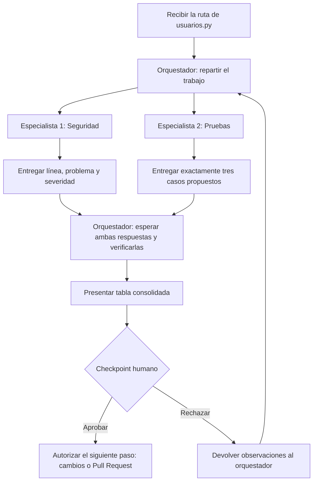
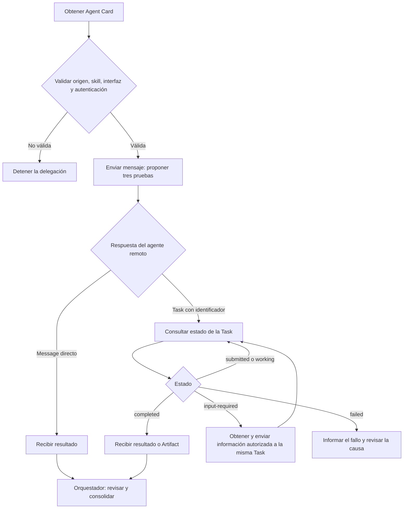

# Parte 1: Diseño del equipo de agentes

El equipo revisará `usuarios.py`, un módulo que busca y crea usuarios en SQLite, calcula descuentos y comprueba la clave de administrador. Este documento describe el equipo e incluye la sección A2A; la propuesta A2UI se presenta en `respuestas.md`.

## Agentes y responsabilidades

| Agente | Misión | Herramientas autorizadas | Entrada | Salida | Límites |
| --- | --- | --- | --- | --- | --- |
| Orquestador | Recibir la ruta, repartir la revisión entre los dos especialistas en paralelo y reunir sus respuestas en una tabla. | Ninguna herramienta propia; únicamente delega y consolida las respuestas de los especialistas | `C:\Users\Gabriel\Desktop\USFQ\ProgAsistida\deber6-agentes\usuarios.py` y las respuestas de ambos especialistas. | Tabla consolidada con el origen de cada resultado y su estado de revisión. | No modifica archivos, no ejecuta el módulo y no aprueba cambios ni abre un Pull Request. |
| Especialista 1 — Seguridad | Buscar claves o tokens escritos directamente en el código y entradas de usuario sin validar. | Solo lectura con `Get-Content` y búsqueda con `rg -n`. | `C:\Users\Gabriel\Desktop\USFQ\ProgAsistida\deber6-agentes\usuarios.py`. | Por cada hallazgo: línea verificada, problema y severidad (alta, media o baja), con una razón breve. | Solo lee y busca. No modifica archivos, no ejecuta código y no inventa hallazgos ni números de línea. |
| Especialista 2 — Pruebas | Proponer exactamente tres casos de prueba que falten, indicando qué función revisar y qué se espera. | Solo lectura con `Get-Content` y búsqueda con `rg`. | `C:\Users\Gabriel\Desktop\USFQ\ProgAsistida\deber6-agentes\usuarios.py`. | Exactamente tres propuestas distintas, cada una con función, entrada y resultado esperado. | Solo lee y propone. No crea ni ejecuta pruebas, no modifica archivos y no afirma que una prueba pasó o falló. |

La tabla consolidada tendrá estas columnas: **agente, función o línea verificada, problema o caso propuesto, severidad, resultado esperado y estado**. Para las pruebas se usará el nombre de la función y la severidad será «No aplica»; no se inventarán líneas para pruebas que aún no existen.

## Tres casos de prueba propuestos

Estos resultados esperados son propuestas para revisión humana. No representan pruebas ejecutadas ni comportamiento ya implementado.

1. **Búsqueda con una entrada que intenta alterar la consulta:** llamar a `buscar_usuario("' OR 1=1 --")` en una base de prueba con varios usuarios. Se espera que el texto se trate como un nombre literal y que no devuelva todos los usuarios.
2. **Creación con edad negativa:** llamar a `crear_usuario("Ana", -1, "ana@ejemplo.com")`. Se espera que se rechace la edad y que no se guarde el usuario.
3. **Descuento mayor al 100 %:** llamar a `calcular_descuento(100, 150)`. Se espera que se rechace el porcentaje por estar fuera del rango de 0 a 100.

## Flujo de trabajo



Las dos ramas de especialistas se realizan en paralelo. El orquestador espera ambas respuestas antes de presentar el resultado como completo.

## Checkpoint humano

Antes de aprobar cualquier cambio o abrir un Pull Request, una persona debe revisar la tabla y dar su aprobación explícita. La aprobación del informe no autoriza por sí sola a modificar archivos ni a abrir un Pull Request.

La persona debe comprobar que cada hallazgo corresponde al código y a su línea real, que la severidad tiene una justificación y que las tres pruebas son distintas y tienen sentido. También debe verificar que se respetaron los límites y que `usuarios.py` sigue intacto.

Se debe rechazar el resultado si contiene hallazgos o líneas inventadas, faltan datos, hay una cantidad de pruebas distinta de tres, los resultados esperados no están claros o se modificó algún archivo sin autorización. En esta parte solo se entrega el diseño; cualquier cambio posterior requiere revisar su contenido concreto antes de aprobarlo.

## Cómo detectar y manejar fallos

El orquestador detectará un fallo si un especialista no responde, informa un error, indica que revisó otra ruta o entrega una respuesta incompleta. Comprobará que las respuestas tengan el formato solicitado y estén completas. En Seguridad verificará que incluyan línea, problema, severidad y explicación breve. La comprobación de los hallazgos contra las líneas reales de `usuarios.py` corresponde al especialista de seguridad o a la persona responsable durante el checkpoint humano. Si no se reportan hallazgos, pedirá indicar qué se revisó. En Pruebas contará exactamente tres casos y comprobará que no estén repetidos y que incluyan entrada y resultado esperado. El orquestador no utiliza herramientas propias ni accede directamente al archivo.

Si hay un fallo, marcará esa parte como **incompleta**, conservará los resultados válidos y pedirá al especialista que repita o corrija su revisión. No rellenará información por su cuenta. Si el problema continúa, lo explicará a la persona responsable y no presentará el informe como completo ni avanzará a cambios o a un Pull Request.

## A2A

En este escenario, el Especialista 2 pertenece a otra empresa y funciona en un servidor remoto. El orquestador le solicita exactamente tres casos de prueba para el archivo Python, sin pedirle que los ejecute ni que cambie el código.

La siguiente Agent Card es ilustrativa. El endpoint es ficticio y no contiene credenciales.

Simplificación didáctica; no es JSON conforme a una versión específica de A2A

```json
{
  "name": "especialista-pruebas-remoto",
  "description": "Agente de otra empresa que propone pruebas para archivos Python.",
  "version": "1.0.0",
  "url": "https://agente.ejemplo/a2a",
  "preferredTransport": "JSONRPC",
  "capabilities": {
    "streaming": true
  },
  "defaultInputModes": ["text/plain"],
  "defaultOutputModes": ["text/plain"],
  "skills": [
    {
      "id": "proponer-pruebas",
      "name": "Propuesta de tres pruebas",
      "description": "Propone exactamente tres casos distintos con función, entrada y resultado esperado, sin ejecutarlos.",
      "tags": ["python", "pruebas"]
    }
  ],
  "securitySchemes": {
    "bearerAuth": {
      "type": "http",
      "scheme": "bearer"
    }
  },
  "security": [
    {"bearerAuth": []}
  ]
}
```

El cliente obtendría la tarjeta desde una dirección acordada con la empresa, por ejemplo, `https://agente.ejemplo/.well-known/agent-card.json`, o mediante un catálogo confiable. Antes de delegar, comprobaría lo siguiente:

- **Origen:** el dominio, HTTPS y la identidad de la empresa deben coincidir con el proveedor esperado. La tarjeta por sí sola no garantiza confianza.
- **Skill:** el agente debe ofrecer la propuesta de tres pruebas con el alcance solicitado.
- **Interfaz:** el protocolo, su versión, los formatos y el endpoint deben ser compatibles con el cliente.
- **Autenticación:** el cliente debe conocer el mecanismo requerido y contar con autorización. El token se obtendría por un canal seguro, fuera de la tarjeta; el servidor debe comprobarlo y limitar el acceso.

Estas formas de descubrimiento se describen en la [documentación oficial de A2A](https://a2a-protocol.org/latest/topics/agent-discovery/).



Una respuesta directa entrega el resultado sin seguimiento de una tarea. Una `Task` tiene un identificador que permite consultar su avance. Un `Artifact` puede contener la lista estructurada de pruebas; no tiene que ser un archivo. Si ambos extremos admiten streaming, el cliente también puede recibir actualizaciones mientras espera. El diagrama muestra la alternativa de consultar el estado. [Ciclo de una tarea A2A](https://a2a-protocol.org/latest/topics/life-of-a-task/).

| Estado | Significado y reacción del orquestador |
| --- | --- |
| `submitted` | La tarea fue recibida y confirmada; el orquestador espera su avance. |
| `working` | El agente está preparando las propuestas; el orquestador sigue el progreso. |
| `completed` | La tarea terminó correctamente. El orquestador comprueba que haya exactamente tres casos útiles antes de consolidarlos. |
| `failed` | La tarea terminó con un error. El orquestador informa la causa disponible y marca esa parte como incompleta. Un nuevo intento requiere otra tarea. |
| `input-required` | Falta información para continuar. El orquestador solicita los datos necesarios y responde usando el identificador de la misma tarea y su contexto. |

Los estados se presentan con nombres simplificados para explicar el flujo; su representación concreta depende de la versión acordada. [Estados de A2A](https://a2a-protocol.org/latest/specification/#413-taskstate).

Frente al subagente local, la comunicación pasa a realizarse por red y puede sufrir demoras o cortes. La Agent Card permite descubrir al agente y acordar una interfaz común, aunque cada empresa utilice una implementación distinta. El agente remoto tiene los permisos de su propio servidor: no hereda los permisos locales ni puede leer una ruta del computador del cliente por recibir su nombre.

La delegación cruza un límite de confianza entre empresas. El cliente solo enviaría contenido autorizado y necesario, sin secretos, y revisaría la respuesta como información externa. La tarjeta y el protocolo no garantizan que el resultado sea correcto ni autorizan cambios. El checkpoint humano sigue siendo necesario antes de aprobar cambios o abrir un Pull Request.

**MCP y A2A cumplen funciones diferentes:** MCP conecta agentes con herramientas y recursos, como un lector de archivos o una base de datos; A2A permite delegar tareas a agentes remotos. El especialista remoto podría usar MCP internamente para acceder a sus herramientas, mientras el orquestador se comunica con él mediante A2A. [Introducción oficial de MCP](https://modelcontextprotocol.io/docs/getting-started/intro).
